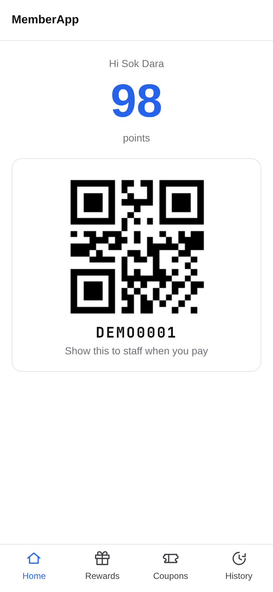
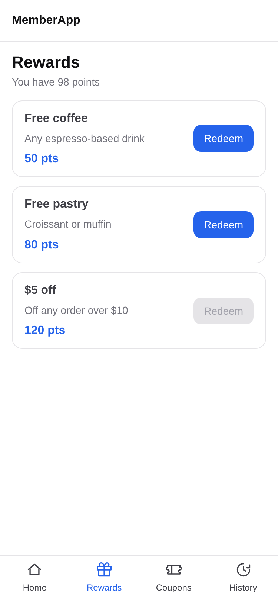
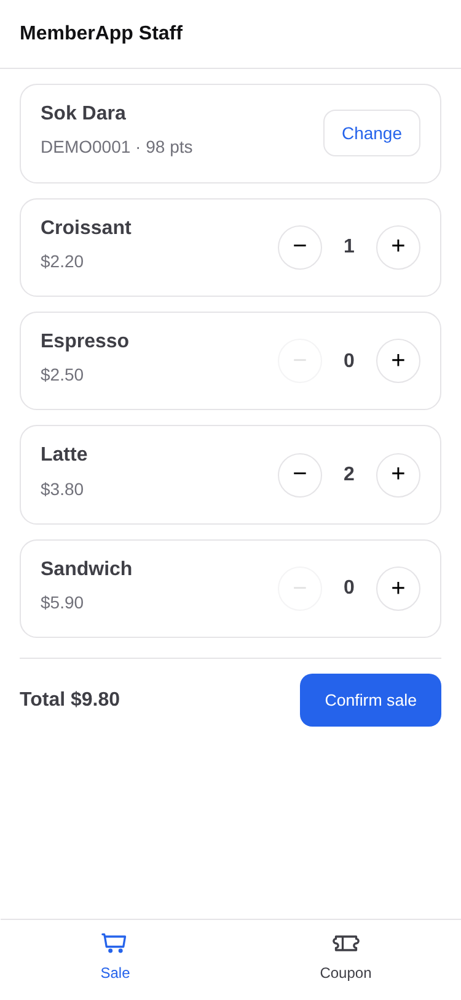
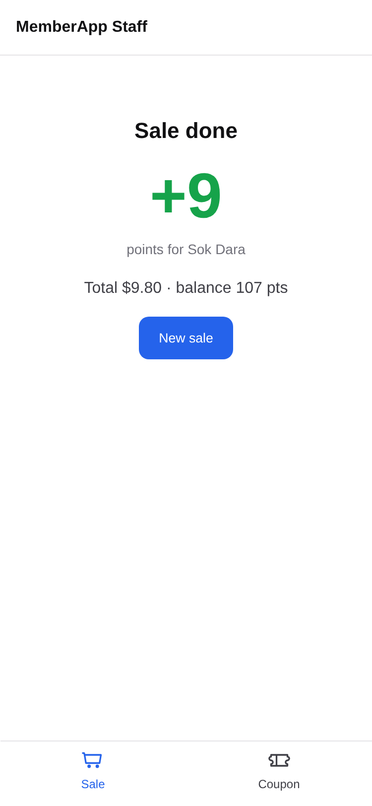
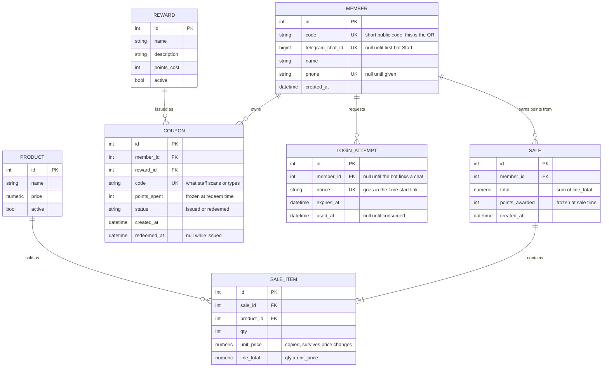

# MemberApp

A shop loyalty system. Staff scan a customer's QR code, ring up products, and the
sale awards points automatically. Customers watch their balance and swap points
for coupons.

Standalone portfolio project: own backend, own database, own frontend. Built on
the same stack as the POS project in this repo (FastAPI + SQLAlchemy + Postgres,
React + Vite, docker-compose), but it does not depend on it.

<p>
  
  
  
  
  
</p>

Customer screens: login, home (balance + QR), rewards, coupons, history. Staff
screens: sale, coupon check. Designed for a 375px phone viewport.

## How it works

1. The customer opens the app and logs in through a Telegram bot. No password.
2. Their home screen shows their points balance and a QR code of their member code.
3. Staff scan that QR (or type the code), confirm the member's name, then add
   products and quantities. The system computes the total.
4. On confirm, the backend sums the line totals and awards
   `floor(total x POINTS_PER_UNIT)` points. The customer's balance updates.
5. The customer browses rewards and redeems one. That issues a coupon with its
   own code and QR.
6. Staff scan the coupon to validate it. It can only be redeemed once.

## Run it

Needs Docker, or Python 3.14 + Node 22 + Postgres for a native run.

```bash
cp backend/.env.example backend/.env   # then fill in the values below
docker compose up -d --build
docker compose exec backend python seed.py
```

Open http://localhost:5174 for the customer app and http://localhost:5174/staff for
staff. The API is on http://localhost:8002 (docs at `/docs`). Ports are offset from
the POS project (db 5434, backend 8002, frontend 5174) so both can run together.

Native: `cd backend && pip install -r requirements.txt && uvicorn main:app --reload --port 8002`
and `cd frontend && npm install && npm run dev -- --port 5174`.

`python seed.py` is safe to repeat. It adds 4 products, 3 rewards and a demo
member with code `DEMO0001`.

### Configuration (`backend/.env`)

| Variable | Purpose |
|---|---|
| `DATABASE_URL` | Postgres connection string (required) |
| `TELEGRAM_BOT_TOKEN` | From @BotFather. Without it the bot is off and customer login returns 503 |
| `JWT_SECRET` | Signs customer tokens. Use 32+ random characters |
| `STAFF_KEY` | Shared key staff type at `/staff/login`. Unset means every staff route returns 503 |
| `POINTS_PER_UNIT` | Points per 1 currency unit, default 1 |

### Telegram login

A bot can only message someone who has pressed Start on it, so every login uses a
deep link: the app asks the backend for a one-time nonce, shows a
`t.me/<bot>?start=<nonce>` button, and polls until the bot links that chat to a
member. The bot runs as long polling inside the backend, so it needs no public URL.
Switch to a webhook before deploying.

## API

Customer routes take `Authorization: Bearer <jwt>`; staff routes take `X-Staff-Key`.

| Route | Who | What |
|---|---|---|
| `POST /auth/start`, `POST /auth/verify` | public | Telegram deep-link login, returns a JWT |
| `GET /me`, `GET /me/history` | customer | Name, code, balance; earned/spent ledger |
| `GET /rewards` | customer | Active rewards, cheapest first |
| `GET /me/coupons`, `POST /me/coupons` | customer | List coupons; redeem a reward (409 if not enough points) |
| `GET /products` | staff | Active products |
| `GET /members/{code}` | staff | Name and balance, to confirm who was scanned |
| `POST /sales` | staff | `{member_code, items:[{product_id, qty}]}` returns total, points, new balance |
| `POST /coupons/{code}/redeem` | staff | Marks a coupon used (409 if already used) |
| `GET /health` | public | Database check |

## Tests and lint

```bash
cd backend && pip install -r requirements-dev.txt && python -m pytest tests && pylint *.py models routers schemas tests
cd frontend && npm run lint
```

13 backend tests cover the login flow, redeeming, balance maths, sale totals and
points rounding, and single-use coupons. They call the route functions directly with
an in-memory SQLite database. There are no frontend tests.

## Diagrams

### Entity relationship



Three things in the schema are deliberate:

- `sale_item.unit_price` and `sale.points_awarded` are frozen copies, so changing
  a product price or the earn rate later doesn't rewrite history.
- `coupon.status` and `redeemed_at` are what make a coupon single-use.
- There is no `points_balance` column. The balance is
  `sum(sale.points_awarded) - sum(coupon.points_spent)` for that member, so
  nothing can drift out of sync with the ledger.

### User flow

[docs/user-flow.mmd](docs/user-flow.mmd): customer, staff and backend lanes,
covering login, scan, sale, redeem and coupon validation.

## Tech

| Part | Choice |
|---|---|
| Backend | FastAPI, SQLAlchemy, Postgres. One file per route, model and schema |
| Frontend | React 19 + Vite, plain CSS, one app with `/staff/*` and `/*` route trees |
| Customer auth | Telegram bot (deep-link on every login), JWT. No SMS provider |
| Staff auth | Shared key from `.env` |
| QR | `qrcode` to generate, `html5-qrcode` to scan (works on iOS Safari) |
| Dev | docker-compose, hot reload on both services |

## Known limits

- Tables are created on startup with `create_all`; there are no migrations.
- Camera scanning needs HTTPS or localhost. On a plain-http LAN address use the
  type-the-code box.
- One shared staff key, no staff accounts or audit trail of who rang up a sale.
- Dev setup only. Change `JWT_SECRET` and `STAFF_KEY`, and serve over HTTPS, before
  any real deployment.

## Out of scope

Stock tracking, receipts, points expiry, tiers, refunds, multiple shops, staff
accounts and roles, admin dashboard. They are left out on purpose, so they stay
decisions rather than omissions.
